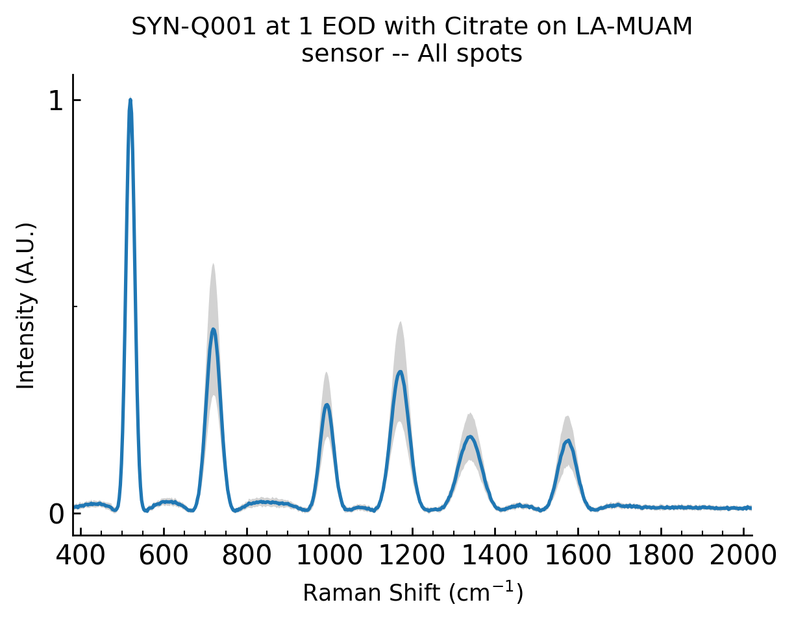
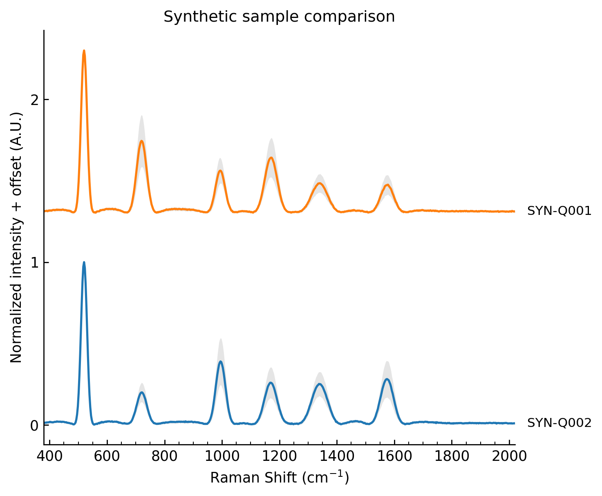
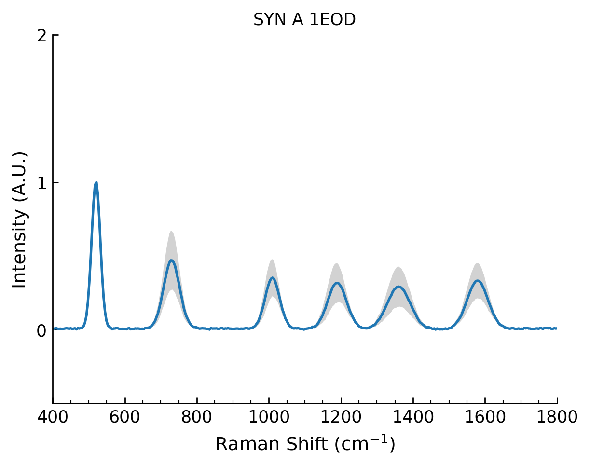
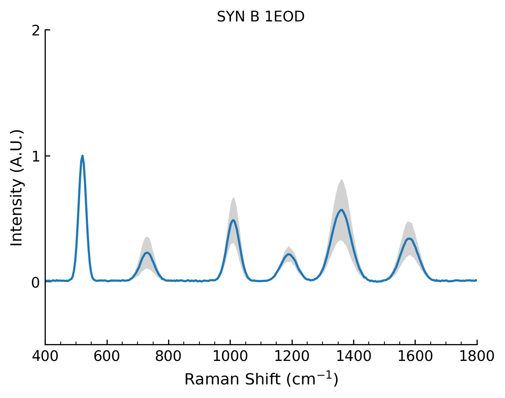
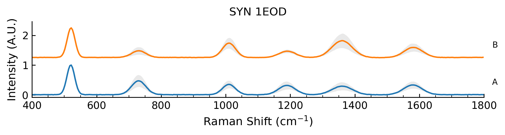

# Raman Spectroscopy — Processing & Plotting

Python tools for turning **XploRA Raman maps** and **portable i-Raman spectra** into clean average spectra, sample comparisons, and exportable figures. Designed for routine use in the Ragan Lab.

## What do the scripts produce?

### XploRA Raman maps

| One map — mean ± SD | All maps in one sample — pooled mean ± SD |
|:---:|:---:|
|  |  |

**Compare sample averages** (vertically offset, with ±SD shading and sample labels):



### Portable i-Raman

The i-Raman script saves **one mean ± SD PNG and CSV for each sample**, followed by a combined comparison PNG (when there are at least two samples).

| Sample A — mean ± SD | Sample B — mean ± SD |
|:---:|:---:|
|  |  |

**Compare samples** (vertically offset, with ±SD shading and labels):



*All figures were generated by the scripts from included **synthetic demonstration spectra**, not experimental measurements. Gray shading shows ±1 standard deviation across spectra (not biological replicates). Synthetic Raman peak intensities were varied to make the SD bands visible.*

## Which script do I use?

| Goal | Script | Output |
|---|---|---|
| Plot the average of **each XploRA map** | [`plot_xplora_maps.py`](scripts/xplora/plot_xplora_maps.py) | One mean ± SD PNG per map |
| Pool **all maps in one XploRA sample** | [`plot_xplora_sample.py`](scripts/xplora/plot_xplora_sample.py) | Pooled mean ± SD PNG and CSV |
| Compare **XploRA sample averages** | [`compare_xplora_samples.py`](scripts/xplora/compare_xplora_samples.py) | Labeled, vertically offset PNG |
| Process a **portable i-Raman experiment day** | [`plot_iraman_samples.py`](scripts/iraman/plot_iraman_samples.py) | Per-sample PNGs and CSVs, plus a comparison PNG |

## Install (Windows / VS Code)

Open the repository folder in VS Code, then run in the terminal:

```powershell
py -m venv .venv
.\.venv\Scripts\Activate.ps1
python -m pip install -r requirements.txt
```

If PowerShell blocks activation, use `.\.venv\Scripts\python.exe` instead of `python` in the install and usage commands. On macOS/Linux: `python3 -m venv .venv`, `source .venv/bin/activate`, then install the requirements.

**Run the commands below from the repository's top-level folder.** Replace an example path with your own data path when ready.

## Try the scripts

**XploRA — one map:**

```powershell
python scripts/xplora/plot_xplora_maps.py "examples/xplora/SYN-Q001_1EOD_Citrate_LA_MUAM/Spot1.txt"
```

**XploRA — pool all maps belonging to one sample (run once per sample):**

```powershell
python scripts/xplora/plot_xplora_sample.py "examples/xplora/SYN-Q001_1EOD_Citrate_LA_MUAM"
python scripts/xplora/plot_xplora_sample.py "examples/xplora/SYN-Q002_1EOD_Citrate_LA_MUAM"
```

**XploRA — compare the saved sample summaries:**

```powershell
python scripts/xplora/compare_xplora_samples.py "results/all_spots_average/*_all_spots_average.csv" --title "Synthetic sample comparison" --offset 1.3
```

XploRA outputs are saved under `results/` in the current working folder. The sample-comparison plot labels curves by the distinguishing parts of the CSV filenames; use `--no-labels` for an unlabeled version.

**Portable i-Raman — process a day containing sample subfolders:**

```powershell
python scripts/iraman/plot_iraman_samples.py "examples/iraman/synthetic_day" --offset 1.25
```

i-Raman outputs are saved under the input day's `results/` folder. Each immediate sample subfolder should contain `SP_1.txt`, `SP_2.txt`, etc.

## Use your own Raman data

- **XploRA:** raw map `.txt` files with map coordinates and multiple spectra, typically named `Spot1.txt`, `Spot2.txt`, etc. For pooled samples, the files must share the same Raman-shift grid.
- **i-Raman:** a day folder with sample subfolders containing semicolon-delimited `SP_*.txt` files (one header row and shift/intensity columns).
- To see additional settings for any script, add `--help`. For input file illustrations, see [`examples/`](examples/).

**Processing defaults differ by instrument.** Both apply ALS baseline correction and silicon normalization by default, but their parameters and outlier filtering differ. See [processing details](docs/METHODS.md) for the exact methods, assumptions, and limitations. The plots' ±SD shading describes variability between spectra, not uncertainty across biological replicates.

<details>
<summary>For developers and contributors</summary>

The `examples/` directory contains only synthetic data. Tests can be run with `python -m pip install -r requirements-dev.txt` followed by `python -m pytest -q`. Experimental data and generated results should not be committed. Check lab/institution permissions before making the code public or adding a reuse license.

</details>
